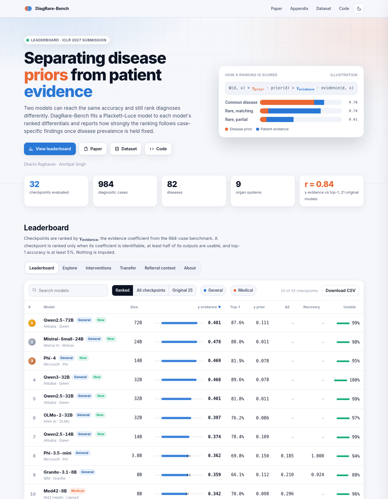

<h1 align="center">DiagRare-Bench: Separating Disease Priors from Patient Evidence in Language Models for Clinical Diagnosis</h1>

<p align="center">
  <a href="https://huggingface.co/spaces/Dharini24/DiagRare-Leaderboard"></a>
  <a href="https://huggingface.co/datasets/Dharini24/DiagRare_Bench"></a>
  
</p>

<p align="center">
  
  
  
  
  
  
</p>

<p align="center">
  
</p>

**DiagRare-Bench** measures how the rankings produced by language models relate to patient findings and disease prevalence. We fit a two-feature Plackett–Luce model to each checkpoint's ranked differential. Its evidence coefficient describes how the fitted preference between two diagnoses varies with their evidence scores after accounting for prevalence. The method uses ranked outputs alone, without model logits or hidden states.

We test the coefficient against changes in clinical evidence, diagnostic revision after new findings arrive, and published case-report datasets. The [interactive leaderboard](https://huggingface.co/spaces/Dharini24/DiagRare-Leaderboard) provides model-level results and comparisons.

<p align="center">
  <a href="https://huggingface.co/spaces/Dharini24/DiagRare-Leaderboard"></a>
</p>

## How it works

1. **Collect ranked diagnoses.** Each of the 984 structured cases includes present and absent findings. A checkpoint returns its three most likely diagnoses from a fixed list of 82 diseases spanning nine organ systems.
2. **Score prior and evidence.** For each candidate diagnosis, `p(d)` is its log-prevalence feature and `e(d, x)` is a case-specific log-likelihood-ratio score computed from the structured disease–finding relationships.
3. **Fit a choice model.** We estimate `U(d, x) = γ_prior · p(d) + γ_evidence · e(d, x)` from ranked outputs. `γ_evidence` describes the association between evidence differences and fitted diagnostic preferences when prevalence differences are held fixed.
4. **Test the measurement.** We compare the baseline coefficient with responses in a randomized 3 × 3 evidence-and-prevalence experiment, sequential diagnostic revision, and the CUPCase and RareArena case-report benchmarks. For the external reports, evidence is measured through text similarity between each case and its candidate diagnoses.

## Results

The leaderboard includes the original 25 open-weight checkpoints and seven additional models evaluated under the baseline protocol. The table shows the leading eligible checkpoints ranked by `γ_evidence`; † identifies the seven additions. The [full leaderboard](https://huggingface.co/spaces/Dharini24/DiagRare-Leaderboard) and [`leaderboard/leaderboard.csv`](leaderboard/leaderboard.csv) include the remaining models and coverage information.

| # | Model | Size | Type | γ evidence | Top-1 (%) | γ prior |
|---:|---|---:|---|---:|---:|---:|
| 1 | Qwen2.5-72B † | 72B | General | **0.481** | 87.6 | 0.111 |
| 2 | Mistral-Small-24B † | 24B | General | **0.478** | 88.0 | 0.011 |
| 3 | Phi-4 † | 14B | General | **0.469** | 81.9 | 0.078 |
| 4 | Qwen3-32B † | 32B | General | **0.468** | 89.6 | 0.078 |
| 5 | Qwen2.5-32B † | 32B | General | **0.401** | 81.8 | 0.011 |
| 6 | OLMo-2-32B † | 32B | General | **0.397** | 76.2 | 0.086 |
| 7 | Qwen2.5-14B † | 14B | General | **0.374** | 78.4 | 0.109 |
| 8 | Phi-3.5-mini | 3.8B | General | **0.362** | 69.8 | 0.150 |
| 9 | Granite-3.1-8B | 8B | General | **0.359** | 66.1 | 0.112 |
| 10 | Med42-8B | 8B | Medical | **0.342** | 70.0 | 0.098 |

The displayed ranking requires an identifiable coefficient, at least 50% usable outputs, and at least 5% top-1 accuracy. Results from other checkpoints remain available in the complete table; missing outputs are not imputed.

### Evidence across evaluation settings

| Evaluation | Result |
|---|---|
| Evidence coefficient and top-1 accuracy across 21 original checkpoints | Pearson `r = 0.843`; Spearman `ρ = 0.860` |
| Same comparison across 17 checkpoints with at least 50% usable outputs | `r = 0.974` |
| Baseline coefficient and response to randomized evidence changes | `r = 0.689` |
| Baseline coefficient and sequential diagnostic recovery | `r = 0.860` |
| Cross-model transfer to CUPCase (3,562 reports) | `r = 0.662` |
| Cross-model transfer to RareArena (22,901 cases) | `r = 0.790` |

The randomized and sequential experiments test the ranking coefficient against behaviors measured separately from the cases used to fit it. Together with the case-report evaluations, they establish how the evidence-related model ordering carries across different diagnostic tasks. We report the coefficient alongside accuracy and task-specific results so that readers can examine both correctness and the full differential.

### Additional experiments

The following analyses extend the main evaluation. Protocols and results appear in **Appendix M**, with tables in [`rebuttal/results/`](rebuttal/results).

- **Larger checkpoints.** Seven additional models, from 14B to 72B parameters, extend the baseline comparison. Evidence coefficients and diagnostic accuracy remain closely associated across the expanded panel.
- **Orphanet phenotype differential.** We evaluate 599 vignettes with ten phenotypically similar candidate diagnoses. Across nine usable models, the evidence coefficient correlates with accuracy (`ρ = 0.92`) and with the coefficient estimated on the primary benchmark (`ρ = 0.88`). The vignettes and scoring feature use the same curated phenotype-frequency information, making this a controlled transfer evaluation.
- **Patient age.** We test 57 pairs of pediatric-onset and adult-onset diseases with child, adult, and unspecified-age prompts. For Qwen2.5-32B, the pediatric diagnosis is chosen in 85% of child cases and 19% of adult cases.
- **Medical knowledge.** Replacing disease names with aliases lowers accuracy from 0.81 to 0.35. Providing the matching disease–finding profiles raises it to 0.76, showing that models can use diagnostic relationships without familiar disease names.
- **Referral context.** In six well-covered models, rare-disease referral framing lowers the fitted prior coefficient. Although overall accuracy changes by less than 3.3 percentage points per model, 7–50% of leading diagnoses change; 62–86% of these switches favor less prevalent diseases.
- **Equal accuracy, different rankings.** Mistral-7B-Instruct and Nous-Hermes-2-7B both achieve 62.4% top-1 accuracy. Their prior coefficients differ by 0.097 (95% confidence interval: 0.060–0.138), and Mistral's top-3 accuracy is 5.4 percentage points lower ([comparison table](rebuttal/results/supporting/mistral_vs_nous_hermes_pair.csv)).
- **Choice-model checks.** We test richer model specifications, alternative likelihoods, teacher-forced scoring, and candidate-set changes. The evidence-related model ordering remains similar across the tested specifications (`ρ ≈ 0.95–1.00`); direct candidate-set re-prompting gives median target–confounder preference changes of 1.3–1.9 percentage points. Formal IIA tests are reported separately in Appendix M.
- **Clinical information and reliability.** Additional tests examine open-ended diagnosis, missing correct candidates, explicit evidence corrections, earlier EHR history, and medical images. Adding relevant earlier history improves diagnostic accuracy in 22 of 23 evaluated models on the tested EHR subset.

### Figures

<p align="center">
  
</p>
<p align="center">
  
</p>

The [`figures/`](figures/) directory contains the thirteen paper figures in SVG and PNG formats.

## Quick start

```bash
git clone https://github.com/rdharini2001/DiagRare.git
cd DiagRare
python -m venv .venv && source .venv/bin/activate
pip install -r requirements.txt
```

Load the benchmark:

```python
from datasets import load_dataset

primary = load_dataset("Dharini24/DiagRare_Bench", "primary")  # 984 cases
sequential = load_dataset("Dharini24/DiagRare_Bench", "sequential_revision")
```

Rebuild the leaderboard results and paper figures from the released tables:

```bash
python leaderboard/build_results.py
python figures/src/paper_figures.py
```

To evaluate a new checkpoint, generate its ranked diagnoses on the primary cases and fit the coefficients with `code/analysis/fit_per_all_models.py`. GPU inference uses `vllm`, `torch`, and `transformers`. Table analysis and plotting use NumPy, pandas, SciPy, Matplotlib, and Statsmodels.

The repository includes aggregate result tables for evaluated checkpoints. Raw checkpoint predictions, some third-party datasets, and certain Orphanet source files are obtained separately. The scripts in `rebuttal/code/` identify the inputs required for the additional analyses.

## Repository layout

```text
code/                 Case construction, inference, coefficient fitting, interventions, and robustness tests
data/                 Structured benchmark data, intervention cases, metadata, and Orphanet-derived suite
tables/               Main and supplementary result tables
rebuttal/             Additional evaluation scripts, inputs, and result tables
results/              Results cited in Appendix M
figures/              Paper figures and plotting scripts
assets/               README illustrations
leaderboard/          Leaderboard site and result builder
site/                 Project website
paper/                Manuscript and supplementary appendix
```

## Intended use and data sources

DiagRare-Bench supports controlled research on how language models rank competing diagnoses. The primary ontology uses stipulated disease–finding relationships to define comparable evidence contrasts. Coefficient values are interpreted within fixed prompts, candidate sets, and scoring rules. Clinical application would require further physician review of the ontology and direct evaluation of diagnostic safety and patient outcomes.

CUPCase and RareArena remain available from their original publishers and are not redistributed here. Orphanet-derived files follow their original CC BY 4.0 terms; model checkpoints remain subject to their respective upstream licenses.

## Citation

```bibtex
@misc{raghavan2026diagrarebench,
  title  = {{DiagRare-Bench: Separating Disease Priors from Patient Evidence in Language Models for Clinical Diagnosis}},
  author = {Raghavan, Dharini and Singh, Amritpal},
  year   = {2026},
  note   = {Under Review}
}
```
