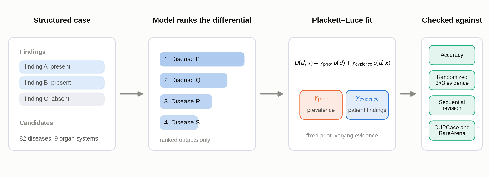
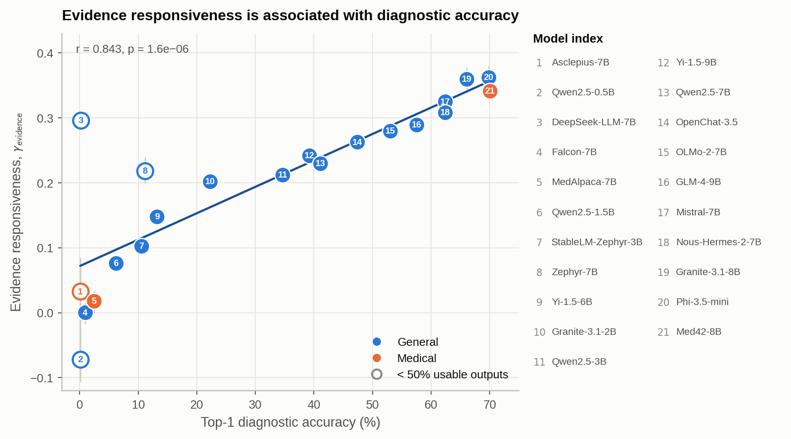
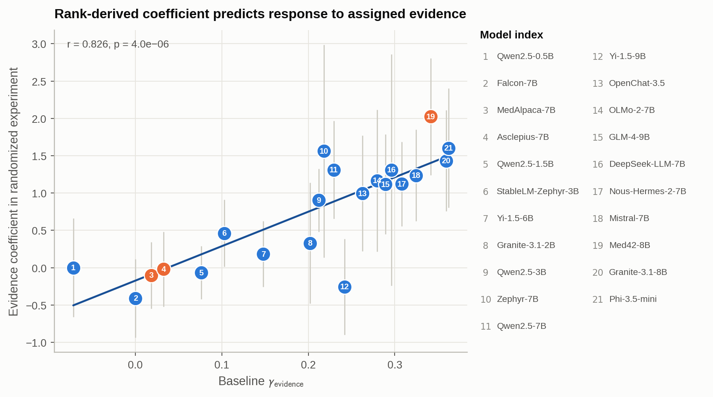

<h1 align="center">DiagRare-Bench: Separating Disease Priors from Patient Evidence in Language Models for Clinical Diagnosis</h1>

<p align="center">
  <a href="https://huggingface.co/spaces/Dharini24/DiagRare-Leaderboard"></a>
  <a href="https://huggingface.co/datasets/Dharini24/DiagRare_Bench"></a>
  
</p>

<p align="center">
  
  
  
  
  
  
  
</p>

<p align="center">
  
</p>

DiagRare-Bench measures how strongly a language model's ranked differential diagnosis follows case-specific patient evidence after a disease-prevalence feature is accounted for. Two models can reach the same accuracy and still weigh prevalence and findings differently, or respond differently when new findings arrive. A two-feature Plackett–Luce model is fitted to the ranked outputs, so the method needs no logits, hidden states or reasoning traces.

The [interactive leaderboard](https://huggingface.co/spaces/Dharini24/DiagRare-Leaderboard) lets you sort, filter and compare every checkpoint.

<p align="center">
  <a href="https://huggingface.co/spaces/Dharini24/DiagRare-Leaderboard"></a>
</p>

## How it works

1. A structured case lists the findings of one of 82 diseases across nine organ systems, and the model ranks the 82 candidate diagnoses.
2. A Plackett–Luce model with utility `U(d, x) = γ_prior · p(d) + γ_evidence · e(d, x)` is fitted to the ranked outputs. `p(d)` is the released disease-prevalence feature and `e(d, x)` is a naive-Bayes evidence score for the case.
3. `γ_evidence` says how much stronger findings move a diagnosis up the ranking at fixed prevalence. `γ_prior` is the matching coefficient on prevalence.
4. The coefficient is then checked against behaviour that it was not fitted on: a randomized 3×3 experiment that varies evidence strength and stated prevalence independently, a sequential task in which target-specific findings arrive after an initial answer, and two case-report datasets (CUPCase and RareArena) scored with a different evidence representation.

## Results

Top of the leaderboard. Checkpoints are ranked by γ_evidence on the 984-case benchmark; † marks the seven larger checkpoints added during review (baseline protocol only). The complete table, including unranked checkpoints, is on the [leaderboard](https://huggingface.co/spaces/Dharini24/DiagRare-Leaderboard) and in [`leaderboard/leaderboard.csv`](leaderboard/leaderboard.csv).

| # | Model | Size | Type | γ evidence | Top-1 (%) | γ prior |
|---:|---|---:|---|---:|---:|---:|
| 1 | Qwen2.5-72B † | 72B | General | **0.481** | 87.6 | 0.111 |
| 2 | Mistral-Small-24B † | 24B | General | **0.478** | 88.0 | 0.011 |
| 3 | Phi-4 † | 14B | General | **0.469** | 81.9 | 0.078 |
| 4 | Qwen3-32B † | 32B | General | **0.468** | 89.6 | 0.078 |
| 5 | Qwen2.5-32B † | 32B | General | **0.401** | 81.8 | 0.011 |
| 6 | OLMo-2-32B † | 32B | General | **0.397** | 76.2 | 0.086 |
| 7 | Qwen2.5-14B † | 14B | General | **0.374** | 78.4 | 0.109 |
| 8 | Phi-3.5-mini | 3.8B | General | **0.362** | 69.8 | 0.150 |
| 9 | Granite-3.1-8B | 8B | General | **0.359** | 66.1 | 0.112 |
| 10 | Med42-8B | 8B | Medical | **0.342** | 70.0 | 0.098 |

A checkpoint is ranked when its coefficient is identifiable, at least half of its outputs are usable and its top-1 accuracy is at least 5%. Nothing is imputed.

| Finding | Estimate |
|---|---|
| γ_evidence vs top-1 accuracy, 21 original checkpoints with identifiable coefficients | Pearson r = 0.843, Spearman ρ = 0.860 |
| Same, 17 checkpoints with at least 50% usable outputs | r = 0.974 |
| Baseline γ_evidence vs randomized evidence response ΔE, 21 checkpoints | r = 0.689 |
| Baseline γ_evidence vs sequential recovery, 17 checkpoints | r = 0.860 |
| Ordering on CUPCase and on RareArena vs the primary benchmark, 20 checkpoints each | r = 0.662 and r = 0.790 |
| γ_prior vs top-1 accuracy | r = −0.120 |

The coefficient is strongly associated with accuracy, and the independent behavioural checks point the same way. Held-out, accuracy-adjusted comparisons do not show a consistent predictive gain from adding γ_evidence, so it is reported as an interpretable measurement next to accuracy and not as a standalone model-selection score.

### Analyses added during review

All additions use open-weight models and are documented in Appendix M; tables are in [`rebuttal/results/`](rebuttal/results).

- **Larger checkpoints.** Seven checkpoints from 14B to 72B run under the same baseline protocol; γ_evidence and accuracy remain strongly associated across the 22 ranked checkpoints.
- **Orphanet-grounded differential.** 599 vignettes with 10 phenotypically similar candidates built from curated frequencies; for the nine usable models γ_evidence tracks accuracy (ρ = 0.92) and agrees with the 82-disease coefficient (ρ = 0.88). The vignettes share their frequency source with the evidence feature, so this is a transfer check and not independent validation.
- **Patient-age test.** 57 Orphanet disease pairs with paediatric-only and adult-only onset; most larger models shift their answer sensibly between a child and an adult, and the shift tracks accuracy, not γ_prior.
- **Referral context.** Changing the stated setting from primary care to rare-disease referral lowers γ_prior in all six well-covered models while overall accuracy changes little, and 7–50% of top-1 answers change. This analysis is exploratory.
- **Equal accuracy, different behaviour.** Mistral-7B-Instruct and Nous-Hermes-2-7B both reach 62.4% top-1; their γ_prior differs by +0.097 (95% interval 0.060 to 0.138) and top-3 accuracy by −5.4 points ([table](rebuttal/results/supporting/mistral_vs_nous_hermes_pair.csv)).

### Figures

<p align="center">
  
</p>
<p align="center">
  
</p>

The `figures/` folder holds all thirteen paper figures as SVG and PNG.

## Quick start

```bash
git clone https://github.com/rdharini2001/DiagRare.git
cd DiagRare
python -m venv .venv && source .venv/bin/activate
pip install -r requirements.txt
```

Load the benchmark:

```python
from datasets import load_dataset

primary = load_dataset("Dharini24/DiagRare_Bench", "primary")        # 984 cases
sequential = load_dataset("Dharini24/DiagRare_Bench", "sequential_revision")
```

Rebuild the leaderboard data and the paper figures from the released tables:

```bash
python leaderboard/build_results.py      # regenerates leaderboard/results.{json,js} and leaderboard.csv
python figures/src/paper_figures.py      # the thirteen paper figures, written to figures/
```

Fitting the coefficients for a new model (`code/analysis/fit_per_all_models.py`) needs that model's ranked outputs on the 984 cases; the predictions of the evaluated checkpoints are not redistributed. GPU inference scripts use `vllm`, `torch` and `transformers`; the analysis scripts need only NumPy, pandas, SciPy, Matplotlib and Statsmodels. Some pipelines in `rebuttal/code/` expect raw model outputs, third-party datasets or Orphanet source files that are not redistributed; the released tables record their results.

## Repository layout

```
code/                 benchmark construction, inference, estimation, interventions, robustness
data/                 benchmark-owned structured data, intervention data, metadata, Orphanet-derived suite
tables/               result tables used in the paper, with supplementary and external-validation tables
rebuttal/             scripts, inputs and results for the analyses added during review
results/              files cited by Appendix M
figures/              the thirteen paper figures (SVG, PNG) and the scripts that draw them (src/)
assets/               README figures
leaderboard/          interactive leaderboard (static page) and its data builder
site/                 project page, deployable as a static site
paper/                preprint, revised manuscript and Appendix A to M
```

## Scope

DiagRare-Bench is a research benchmark for diagnostic model behaviour. Its disease–finding relationships are simplified and the ontology's labels define the synthetic scoring rules; independent physician review of the 888 relations and clinical adjudication of open-ended diagnoses remain necessary. The evidence coefficient depends on the evidence scale, prompt, candidate set and decoding rule. The benchmark does not evaluate clinical safety or establish that any checkpoint is suitable for patient care.

CUPCase and RareArena are external datasets and are not redistributed; obtain them from their original repositories and follow their licenses. Orphanet-derived files remain under their original CC BY 4.0 terms. Model checkpoints are governed by their upstream licenses.

## Citation

```bibtex
@misc{raghavan2026diagrarebench,
  title  = {{DiagRare-Bench: Separating Disease Priors from Patient Evidence in Language Models for Clinical Diagnosis}},
  author = {Raghavan, Dharini and Singh, Amritpal},
  year   = {2026},
  note   = {Under Review}
}
```
